# pertanyaan dan tugas

1. Jelaskan perbedaan console.log(), alert(), prompt(), dan textContent/innerHTML. 
2. Apa perbedaan let dan const? Berikan contoh. 
3. Apa perbedaan operator == dan === ? 
4. Jelaskan fungsi if–else dan switch. Kapan masing-masing dapat digunakan? 
5. Apa fungsi parameter dan return dalam function? 
6. Bagaimana JavaScript memilih elemen HTML menggunakan document.getElementById()? 
7. Buat script untuk memvalidasi form agar nama tidak kosong dan nilai berada pada rentang 0–100.

# Jawaban
1.	
A. console.log() digunakan untuk menampilkan informasi atau hasil program di Console browser, biasanya untuk mengecek atau debugging program.
B.	alert() digunakan untuk menampilkan pesan/peringatan berupa kotak dialog kepada pengguna.
C.	prompt() digunakan untuk meminta input dari pengguna melalui kotak dialog.
D.	textContent digunakan untuk mengubah atau menampilkan teks pada elemen HTML.
E.	innerHTML digunakan untuk mengubah atau menampilkan isi HTML, termasuk tag HTML di dalamnya.

2. 
• let digunakan untuk membuat variabel yang nilainya masih dapat diubah.
• const digunakan untuk membuat variabel yang nilainya tidak dapat diubah setelah diberikan nilai.

Contoh:
let umur = 18;
umur = 19; // boleh

const nama = "Lia";
nama = "Ani"; // tidak boleh

3.	
A. == (sama dengan) membandingkan nilai tanpa memperhatikan tipe data dan dapat      melakukan konversi tipe data.
B. === (strict equality) membandingkan nilai dan tipe data, sehingga lebih ketat.

4. if–else digunakan untuk menjalankan kode berdasarkan kondisi tertentu. Cocok digunakan ketika kondisi yang diperiksa cukup beragam atau menggunakan perbandingan.

5.	
•  Parameter adalah nilai yang diberikan kepada function agar function dapat menerima data untuk diproses.
• Return digunakan untuk mengembalikan hasil dari function.

6. document.getElementById() digunakan untuk mencari dan memilih satu elemen HTML berdasarkan atribut id.
contoh HTML:

Teks awal

Contoh JavaScript:
let elemen = document.getElementById("hasil");
elemen.textContent = "Teks berubah";

JavaScript mencari elemen yang memiliki:
id="hasil"

7.	Berikut contoh sederhana:
<form onsubmit="return validasi()">
    <label>Nama:</label>
    <input type="text" id="nama">

      

    <label>Nilai:</label>
    <input type="number" id="nilai">

      

    <button type="submit">Kirim</button>
</form>

Cara kerjanya:
1.	JavaScript mengambil isi nama dan nilai.
2.	Jika nama kosong → muncul peringatan.
3.	Jika nilai kurang dari 0 atau lebih dari 100 → muncul peringatan.
4.	Jika semua benar → data dapat dikirim.

Screenshot hasil (index.html)
Pengenalan JavaScript dan Cek Bilangan 

Ubah Warna dan Daftar Menu Makanan

Mini Project dan Eksperimen Mandiri

Screenshot hasil (javascript)
Hello World, Prompt, dan Operasi Dasar
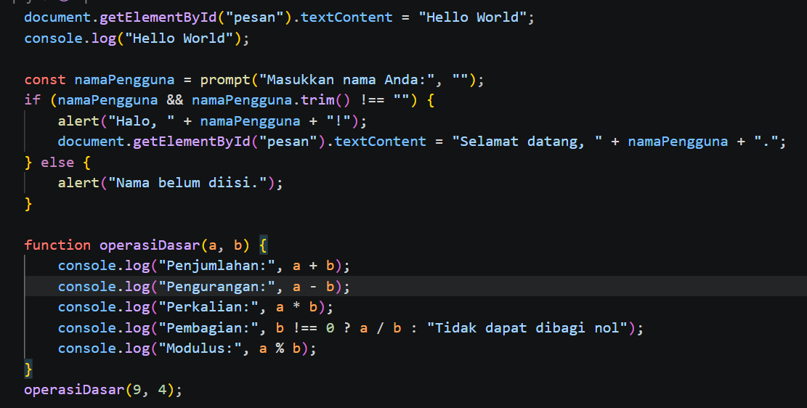

Validasi Nilai, Switch, Cek Bilangan, dan Warna
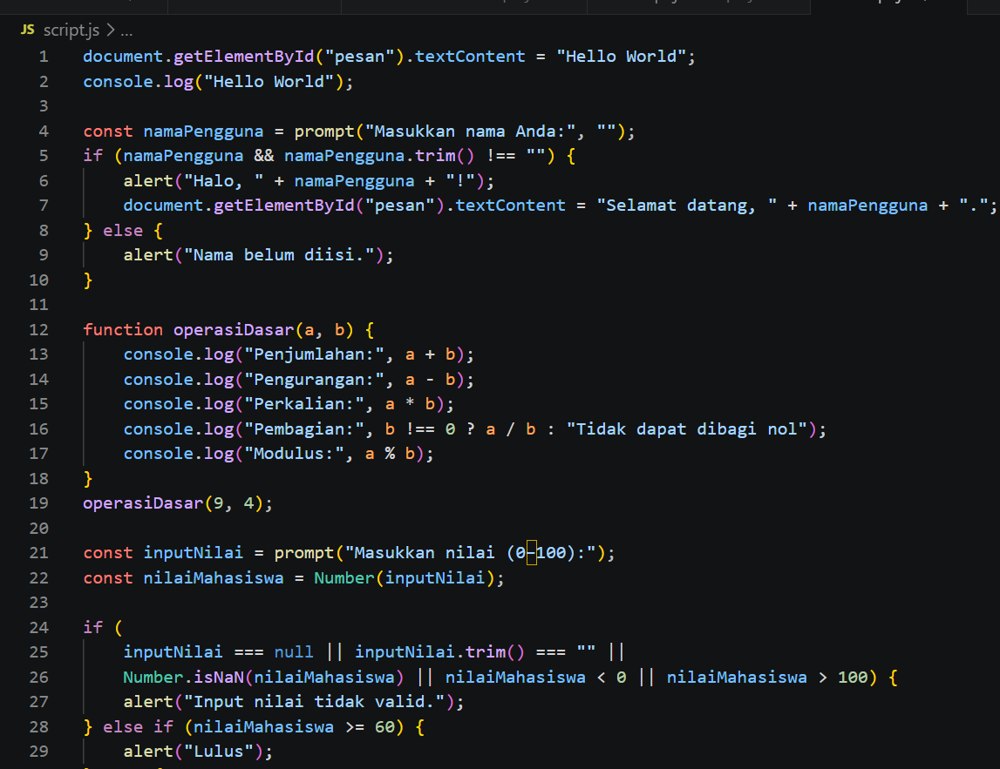
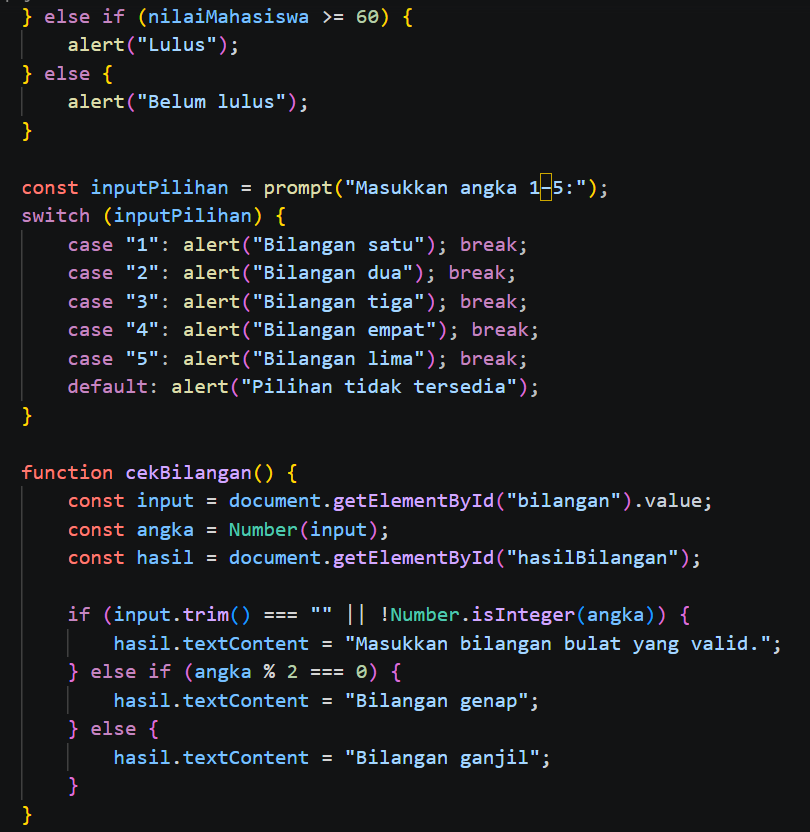

Daftar Menu dan Mini Project
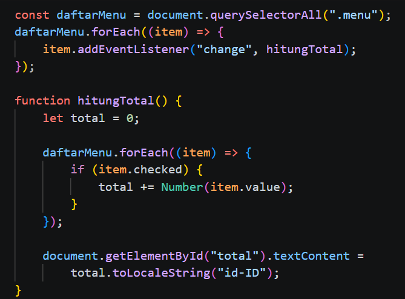
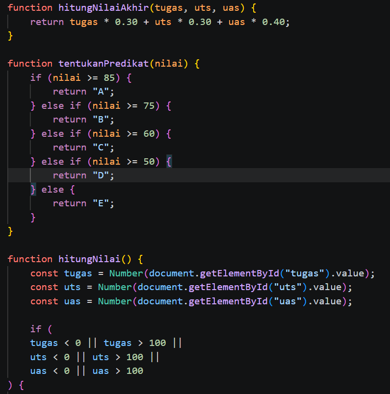
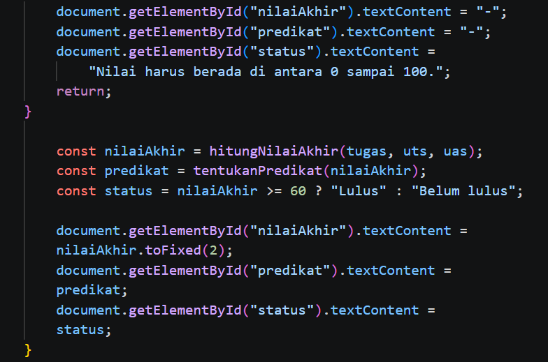

Eksperimen Mandiri Nomor 7, 8, dan 11
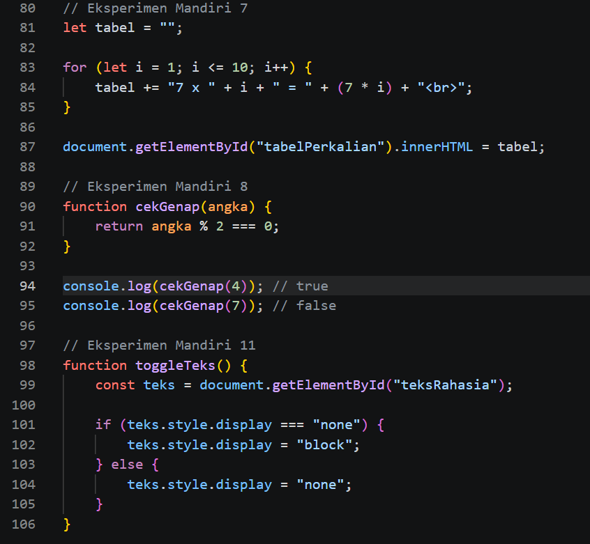

Hasil Tampilan di Web
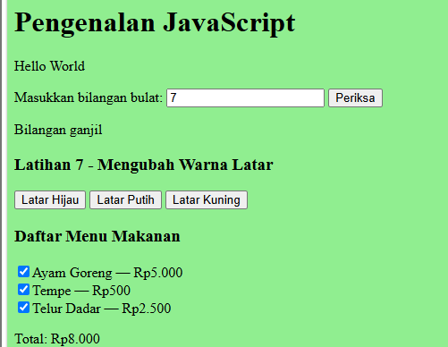
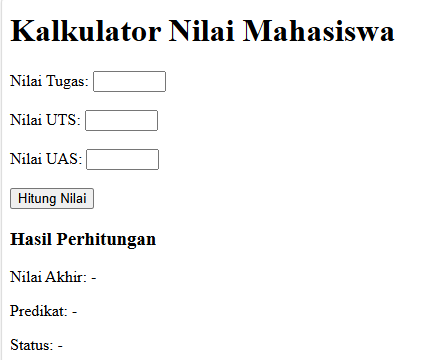
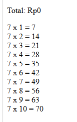
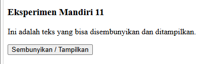
